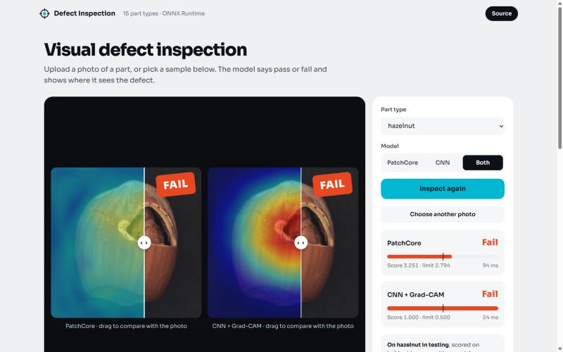
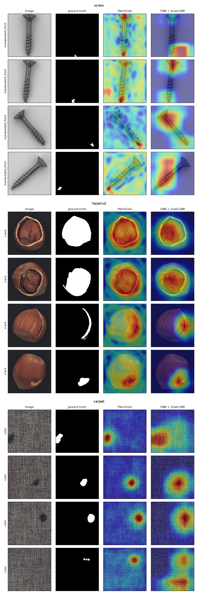

<p align="center"></p>

<h1 align="center">Loupe</h1>

<p align="center"><b>Sees the scratch before your customer does.</b><br>Visual defect inspection for industrial parts: PatchCore anomaly detection against a fine-tuned CNN with Grad-CAM, served with ONNX Runtime.</p>

[](https://github.com/alok-kul5/loupe-vision/actions/workflows/ci.yml)

Detects scratches, cracks, dents, contamination and other defects on industrial parts in
the [MVTec AD](https://www.mvtec.com/company/research/datasets/mvtec-ad) benchmark, and
shows **where** each defect is. It compares two approaches on the same held-out images:

- **PatchCore**, an anomaly detector that learns only from defect-free parts and flags
  anything unlike them;
- **a fine-tuned ResNet-18 classifier** that also gets to train on real defect examples,
  explained with **Grad-CAM** heatmaps.

Experiments are tracked in **MLflow**, the models are exported to **ONNX**, and a
**FastAPI** service with a web page takes a photo and returns pass/fail plus a heatmap.



*The web app: pick a sample part or upload a photo, choose PatchCore, the CNN or both, and drag to compare the photo with the heatmap.*



*Each row: input, ground-truth defect mask, PatchCore heatmap, Grad-CAM heatmap (holdout images).*

## Results

Holdout half of the MVTec AD test set, 15 categories, RTX 5050 laptop GPU.

| | PatchCore (no defects seen) | ResNet-18 + Grad-CAM (trained on defects) |
|---|---:|---:|
| **Mean image AUROC** | **0.988** | 0.966 |
| **Mean pixel AUROC** (defect localisation) | **0.979** | 0.893 |
| Mean F1 at the chosen threshold | 0.956 | 0.865 |
| Defects caught (recall) | 94% | 80% |
| Good parts wrongly rejected | 6% | 10% |

<details><summary>Per category</summary>

| Category | PatchCore image | PatchCore pixel | PatchCore F1 | CNN image | CNN pixel | CNN F1 |
|---|---:|---:|---:|---:|---:|---:|
| bottle | 1.000 | 0.985 | 0.968 | 1.000 | 0.907 | 0.933 |
| cable | 0.997 | 0.985 | 0.969 | 0.951 | 0.830 | 0.825 |
| capsule | 0.984 | 0.987 | 0.973 | 0.973 | 0.896 | 0.857 |
| carpet | 0.979 | 0.988 | 0.957 | 0.822 | 0.935 | 0.849 |
| grid | 0.985 | 0.978 | 0.984 | 0.952 | 0.809 | 0.889 |
| hazelnut | 1.000 | 0.984 | 1.000 | 1.000 | 0.965 | 0.957 |
| leather | 1.000 | 0.990 | 1.000 | 1.000 | 0.960 | 0.932 |
| metal nut | 1.000 | 0.985 | 1.000 | 0.987 | 0.881 | 0.843 |
| pill | 0.956 | 0.977 | 0.931 | 0.956 | 0.904 | 0.844 |
| screw | 0.982 | 0.972 | 0.940 | 1.000 | 0.799 | 0.881 |
| tile | 0.973 | 0.955 | 0.976 | 0.990 | 0.947 | 0.925 |
| toothbrush | 0.978 | 0.986 | 0.933 | 0.933 | 0.869 | 0.571 |
| transistor | 0.997 | 0.976 | 0.750 | 0.932 | 0.864 | 0.750 |
| wood | 0.994 | 0.961 | 0.984 | 1.000 | 0.878 | 0.967 |
| zipper | 0.998 | 0.983 | 0.983 | 1.000 | 0.956 | 0.957 |

</details>

**Where PatchCore is weakest:** pill (0.956), tile (0.973), toothbrush (0.978).
The classifier beats it on image AUROC in: screw, tile, wood, all categories where it trained on examples of the same defect types.

**Thresholds are the weak link, not ranking.** On transistor, PatchCore ranks parts almost perfectly (0.997 AUROC) but scores only 0.75 F1: the threshold picked on the calibration half lets through "misplaced" transistors on the holdout, where the part is missing rather than damaged. In production you would set thresholds per line from a larger calibration set.

Fit plus evaluation takes 80–220 s per category on the laptop GPU. The served ONNX models answer in about 80–190 ms on CPU.

## Method

### A fair comparison

MVTec's training set contains only good parts. Each category's test set is therefore split
50/50 with a fixed seed, **stratified by defect type** ([`defect/data.py`](defect/data.py)):

| | PatchCore | ResNet-18 classifier |
|---|---|---|
| Trains on | defect-free training images only | defect-free training images **plus** the calibration half's defects |
| Decision threshold | best F1 on the calibration half | 0.5 (its calibration defects were used for training, so tuning there would be biased) |
| Scored on | **holdout half** | **the same holdout half** |

The classifier has seen real defects and PatchCore hasn't, so the comparison is generous
to the classifier. In a factory, defect examples are rare and new defect types keep
appearing, and that is exactly the case where anomaly detection earns its place.

### PatchCore ([`defect/patchcore.py`](defect/patchcore.py))

An ImageNet-pretrained WideResNet-50 produces layer2 and layer3 features. These are averaged
over 3×3 neighbourhoods and concatenated into a 1,536-dim descriptor for each of 28×28
patches. A greedy k-center **coreset** keeps 1% of the training patches as a memory bank. A
test patch's anomaly score is its distance to the nearest bank entry. The image score is the
maximum, and the upsampled, Gaussian-smoothed patch scores are the heatmap. This follows
Roth et al., *Towards Total Recall in Industrial Anomaly Detection*, CVPR 2022.

### Classifier + Grad-CAM ([`defect/classifier.py`](defect/classifier.py))

ResNet-18 fine-tuned with class-balanced sampling and light augmentation (flips are
restricted for objects with a fixed orientation). For a network that ends in global average
pooling followed by one linear layer, Grad-CAM for the defect logit equals CAM computed from
the final feature maps and the fc weights; a unit test checks this. So the exported ONNX
model returns its feature maps, and the server computes the heatmap without gradients.

### Metrics ([`defect/metrics.py`](defect/metrics.py))

Per category, on the holdout half:
- **Image AUROC:** ranks defective above good, independent of any threshold.
- **Pixel AUROC:** how well the heatmap separates defect pixels from the rest, measured
  against MVTec's pixel-precise masks.
- **F1, accuracy, defect recall and false-reject rate** at the chosen threshold.

## Running it

```bash
python -m venv .venv && source .venv/bin/activate    # Windows: .venv\Scripts\activate
pip install torch torchvision --index-url https://download.pytorch.org/whl/cu128   # or /cpu
pip install -r requirements-train.txt

# Data: download mvtec_anomaly_detection.tar.xz from the MVTec website and extract to data/mvtec/

python -m defect.train                      # all 15 categories, logged to mlflow.db
mlflow ui --backend-store-uri sqlite:///mlflow.db   # http://localhost:5000
python -m defect.export_onnx                # -> models_onnx/
uvicorn serve.app:app --port 8000           # http://localhost:8000
```

Only want to try the web app? Download the exported models from the GitHub release instead of training:

```bash
pip install -r requirements-serve.txt
python scripts/download_models.py
uvicorn serve.app:app --port 8000
```

Or with Docker (the image downloads the released models; it doesn't need PyTorch):

```bash
docker build -t defect-inspection . && docker run -p 8000:8000 defect-inspection
```

### API

```bash
curl -F file=@part.png -F category=bottle -F method=patchcore http://localhost:8000/api/inspect
```

```json
{"category": "bottle", "method": "patchcore", "verdict": "fail", "score": 3.41, "threshold": 2.16,
 "latency_ms": 180.2, "heatmap_png_base64": "iVBORw0KGgo..."}
```

### Tests

```bash
pytest       # no dataset or GPU needed: PatchCore internals, Grad-CAM = CAM, metrics,
             # preprocessing parity, ONNX export and the full API with tiny stand-in models
ruff check .
```

CI runs the tests, then builds the serving Docker image with the released models and
sends it a real request.

## Project layout

```
defect/
  data.py         MVTec loading, stratified calibration/holdout split, transforms
  patchcore.py    feature extractor, greedy coreset, kNN scoring, heatmap smoothing
  classifier.py   ResNet-18 fine-tuning, Grad-CAM and gradient-free CAM
  metrics.py      image/pixel AUROC, F1, thresholds
  train.py        trains both methods on every category, logs to MLflow, writes results/
  export_onnx.py  ONNX export, checked against PyTorch
  inference.py    ONNX Runtime inference used by the API (no PyTorch)
serve/            FastAPI app and the upload page
tests/
results/          metrics.json and example figures from the last benchmark run
```

## Data licence

MVTec AD is © MVTec Software GmbH and licensed under
[CC BY-NC-SA 4.0](https://creativecommons.org/licenses/by-nc-sa/4.0/). It is not included
in this repository. The example figures are derived from it and shared under the same
licence. The code is MIT.

---

<sub>One of thirteen projects by [Alok Kulkarni](https://alok.is-a.dev): [Hearth](https://github.com/alok-kul5/hearth-iot) home sensors · [Headway](https://github.com/alok-kul5/headway-transit) transit data · [Vigil](https://github.com/alok-kul5/vigil-soc) security triage · **Loupe** defect inspection · [Kharcha](https://github.com/alok-kul5/kharcha-finance) personal finance · [Stockroom](https://github.com/alok-kul5/stockroom-inventory) inventory · [Quietwire](https://github.com/alok-kul5/quietwire-villa) smart home design · [Canopy](https://alok.is-a.dev/canopy/) coffee storefront · [Picket](https://github.com/alok-kul5/picket) detection rules · [Warden](https://github.com/alok-kul5/warden-iac) cloud IaC scanning · [Marquee](https://github.com/alok-kul5/marquee-recs) recommendations · [Kestrel](https://github.com/alok-kul5/kestrel) fraud detection · [Almanac](https://github.com/alok-kul5/almanac-forecast) demand forecasting.</sub>
